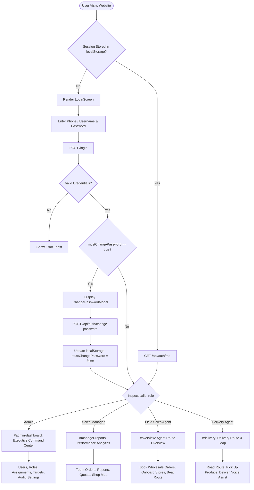

# LineCart 2.0 — Technical Architecture & System Design Documentation

This document provides a comprehensive technical reference for the **LineCart** web platform (`linecart-suite`), re-engineered from the original Android APK (`com.dalavai.linecart`, version 1.0) and extended into a multi-role enterprise suite supporting **Administrators**, **Sales Managers**, **Field Sales Agents**, and **Delivery Agents**.

---

## 1. System Overview

LineCart is a wholesale agricultural route-to-market platform connecting central logistics, regional sales managers, field sales agents, retail merchants, and delivery drivers.

```
+-------------------------------------------------------------------------------+
|                                CLIENT LAYER                                    |
|  React 18 Single Page Application (SPA) · Vite 6 · TailwindCSS · Leaflet Map  |
|  - Multi-Role Shell (Admin, Sales Manager, Field Sales Agent, Delivery Agent) |
|  - Laptop View & Mobile Preview Emulation (390x844px frame)                   |
|  - Accessible Icon-Only Back Button with History Stack & Loop Prevention      |
|  - Responsive 12-Column Layout (Laptop) vs. Stacked Layout (Mobile)          |
+---------------------------------------+---------------------------------------+
                                        | HTTP / JSON (Port 3001)
                                        | Headers: Authorization: Bearer <token> / X-User-Id
+---------------------------------------v---------------------------------------+
|                                EXPRESS BACKEND                                |
|  Node.js (v18+) · Express 4.21 · Multer 1.4 (Multipart) · Static SPA Server   |
+-------------------+-------------------+-------------------+-------------------+
                    |                   |                   |
      +-------------v----+     +--------v---------+    +----v-------------+
      |  Security Guards |     | Business Engines |    | Map & Routing    |
      | - requireAdmin   |     | - Role-Perms     |    | - Leaflet Tiles  |
      | - managerAuth    |     | - Targets Engine |    |   OSM + CartoDB  |
      | - deliveryAuth   |     | - Audit Trail    |    | - OSRM Routing   |
      | - scrypt hashing |     | - Session Store  |    |   + NN Fallback  |
      +-------------+----+     +--------+---------+    +------------------+
                    |                   |
+-------------------v-------------------v---------------------------------------+
|                            DATA STORAGE LAYER                                 |
| - In-Memory State: active sessions (`sessions`), orders (`submittedOrders`)   |
| - Local JSON Config: `admin_config.json` (Users, Targets, Assignments, Audit)  |
| - Static Seed Datasets: `data.js` (Baseline mock shops and catalog)           |
| - Local Uploads: `uploads/` (Storefront verification photographs)             |
+-------------------------------------------------------------------------------+
```

### Request Lifecycle
1. **Client Request**: The browser SPA issues asynchronous `fetch()` calls to `http://localhost:3001`. Client requests carry the authenticated session token via the standard `Authorization: Bearer <token>` header (as well as `X-User-Id`).
2. **Reverse Proxy / Path Normalization**: In `server/index.js`, requests prefixed with the legacy Android proxy URL (`http://freshcubes.in`) are stripped to uniform root-relative paths.
3. **Authentication & Session Identification**:
   - `getCaller(req)` reads the Bearer token from the `Authorization` header, looks up the active session in the server's `sessions` Map, and resolves the authenticated user object.
   - If no token is provided, it falls back to `X-User-Id` or `userid` query parameter.
   - The `/api/auth/me` endpoint enables the client to verify session validity and sync authoritative user profile and role details on application mount.
4. **Authorization Middleware**:
   - `requireAdmin`: Enforces `(caller.role).toLowerCase() === 'admin'`. Rejects unauthorized callers with `403 Forbidden`.
   - `authorizeManagerAccess`: Verifies that a Sales Manager only receives data belonging to explicitly assigned sales agents (`managerAssignments[managerId]`). Admins bypass this check.
   - `requireDeliveryAgent`: Verifies that the caller possesses the `delivery_agent` or `admin` role and enforces that delivery agents can only update orders assigned to their specific ID.
   - `checkActionPermission`: Verifies that the caller's role possesses granular action permissions configured in `rolePermissions`.
5. **Execution & Mutator Layer**: Route handlers update in-memory arrays (`submittedOrders`, `shops`) and persist configuration changes to disk via `savePersistentConfig()` (`admin_config.json`).
6. **Audit Trail**: Mutating operations trigger `addAuditLog(req, action, targetType, targetId, details)`, writing timestamped records with the actor's ID and name to the audit queue.

---

## 2. Directory & File Structure

```
linecart-suite/
├── .env.example                 # Documented template for environment variables
├── .gitignore                   # Excludes secrets, credentials, node_modules, data.js
├── README.md                    # Primary project setup & quick-start guide
│
├── client/                      # Frontend React SPA
│   ├── index.html               # SPA entry point
│   ├── package.json             # Frontend dependencies (React 18, Leaflet, Lucide)
│   ├── vite.config.js           # Vite configuration & dev server proxy
│   ├── tailwind.config.js       # Tailwind CSS design system configuration
│   ├── postcss.config.js        # PostCSS configuration (Autoprefixer, Tailwind)
│   ├── dist/                    # Compiled production build artifacts (served by Express)
│   └── src/
│       ├── main.jsx             # React DOM root render
│       ├── App.jsx              # Main shell: routing, topbar, history stack, previews
│       ├── api.js               # Centralized REST API client (Bearer auth, reports, delivery)
│       ├── routing.js           # OSRM road routing engine & Haversine nearest-neighbor heuristic
│       ├── utils.js             # Formatting, Google Maps links, coordinate checks
│       ├── reference-theme.css  # Design system tokens, mobile preview, .sr-only utility
│       └── components/          # Reusable UI views & modals
│           ├── AdminDashboardScreen.jsx        # Admin command center & KPI breakdown
│           ├── AdminUsersScreen.jsx            # User provisioning, editing & deletion
│           ├── AdminRolesPermissionsScreen.jsx # Role-permissions matrix manager
│           ├── AdminTargetsScreen.jsx          # Revenue quotas and commodity targets manager
│           ├── AdminAuditScreen.jsx            # Security audit trail filter & viewer
│           ├── AdminSettingsScreen.jsx         # Organization branding & maintenance mode
│           ├── TeamAssignmentsScreen.jsx       # Manager-to-agent mapping interface
│           ├── ManagerReportsScreen.jsx        # Sales manager target vs achieved analytics
│           ├── ManagerOrdersScreen.jsx         # Sales manager scoped orders ledger
│           ├── ShopMapScreen.jsx               # Leaflet map with ordered/non-ordered pins & spiderfying
│           ├── DeliveryRouteScreen.jsx         # Touch-friendly delivery workflow with Leaflet & speech
│           ├── OrderEntryScreen.jsx            # Field agent order placement & calculation
│           ├── OrderBooking.jsx                # Item catalog order booking screen
│           ├── CustomersScreen.jsx             # Customer shop directory & onboarding form
│           ├── RegisterShop.jsx                # Retail store registration with GPS capture
│           ├── LoginScreen.jsx                 # Multi-role authentication & dev shortcuts
│           ├── ChangePasswordModal.jsx         # Mandatory first-login password change modal
│           └── ErrorBoundary.jsx               # React runtime error boundary
│
├── server/                      # Backend Express Application
│   ├── index.js                 # Primary server: routing, auth, guards, audit, endpoints
│   ├── package.json             # Backend dependencies (express, cors, multer)
│   ├── data.loader.js           # Smart fallback data loader (data.js -> data.demo.js)
│   ├── data.js                  # Production/real data file (GITIGNORED)
│   ├── data.demo.js             # Sanitized synthetic dataset for repository sharing
│   └── admin_config.json        # Local persistent configuration file (GITIGNORED)
│
├── docs/                        # Project Documentation
│   ├── ARCHITECTURE.md          # This technical architecture specification
│   ├── USER_GUIDE.md            # Role-by-role practical operations manual
│   ├── LIBRARIES_AND_TOOLS.md   # Installed dependencies and external services reference
│   └── KNOWN_LIMITATIONS.md     # In-memory boundaries and production deployment checklist
│
└── scratch/                     # Automated test suites
    ├── test_navigation_and_previews.js   # Navigation, Back buttons, logout, previews
    ├── test_route_map_fix.js             # Leaflet tiles and coordinate fan-out verification
    └── test_delivery_agent_workflow.js   # Delivery status transitions and security guards
```

---

## 3. End-to-End User Workflows



---

## 4. Authentication, Authorization & Security

### Cryptographic Password Hashing
Passwords are never stored in plaintext. Passwords are encrypted using Node.js native `crypto.scryptSync`:
```javascript
const salt = crypto.randomBytes(16).toString('hex');
const hash = crypto.scryptSync(password, salt, 64).toString('hex');
const storedPassword = `scrypt:${salt}:${hash}`;
```
During authentication, the candidate password is treated with the stored salt and evaluated using timing-safe comparison (`crypto.timingSafeEqual`).

### Session Invalidation & Logout
Upon successful authentication, the server generates a cryptographically secure UUID session token and registers it in the `sessions` Map with the user ID, role, and login timestamp:
```javascript
sessions.set(sessionToken, {
  userId: user.id,
  user: user,
  createdAt: Date.now()
});
```
When a user signs out via `POST /api/auth/logout`:
1. The token is removed from `sessions.delete(sessionToken)`.
2. Any subsequent request presenting that token receives `401 Unauthorized`.
3. Client `localStorage` is cleared.

### Role & Permission Checks
- **`requireAdmin`**: Enforces strict administrator role verification.
- **`authorizeManagerAccess`**: Restricts managers to data belonging exclusively to their supervised team.
- **`requireDeliveryAgent`**: Protects `/api/delivery/*` routes, ensuring agents cannot alter orders assigned to other drivers.
- **Last Active Administrator Safeguard**: The system blocks deleting, demoting, or deactivating the last remaining active Administrator to prevent lockout.

---

## 5. Comprehensive API Directory

### System & Authentication Endpoints
- `GET /api/system/mode`: Returns environment mode (`development` vs `production`).
- `GET /api/demo-users`: Returns list of demo test accounts (disabled in production).
- `POST /login` (Aliases: `/api/linecart/login`, `/admin_panel/public/api/linecart/login`): Authenticates credentials, creates session token, returns user profile and `mustChangePassword` status.
- `GET /api/auth/me`: Authenticates active Bearer token, returns authoritative user and role data.
- `POST /api/auth/logout`: Terminates active session token.
- `POST /api/auth/change-password`: Validates old password and sets new scrypt-hashed password.

### Administrator Endpoints
- `GET /api/admin/dashboard`: Organization-wide KPI metrics and recent audit events.
- `GET /api/admin/users`: List of all system users with role and cluster metadata.
- `POST /api/admin/users`: Provisions a new user account.
- `PUT /api/admin/users/:id`: Updates an existing user's name, role, phone, or password.
- `POST /api/admin/users/:id/status`: Toggles user account active/inactive status.
- `DELETE /api/admin/users/:id`: Deletes a user account with safety checks.
- `GET /api/admin/permissions`: Fetches role-action permissions matrix.
- `PUT /api/admin/permissions`: Updates role-action permissions matrix.
- `GET /api/admin/orders`: Organization-wide orders ledger.
- `GET /api/admin/reports`: Organization-wide revenue and performance reports.
- `GET /api/admin/targets`: Lists all configured sales revenue and commodity targets.
- `POST /api/admin/targets`: Creates or updates a sales revenue and commodity target quota.
- `DELETE /api/admin/targets/:id`: Deletes a target quota.
- `GET /api/admin/items`: Lists all commodity products available for quota allocation.
- `GET /api/admin/audit`: Administrative audit log trail.
- `GET /api/admin/settings`: System branding and operational settings.
- `PUT /api/admin/settings`: Updates system settings.

### Sales Manager Endpoints
- `GET /api/manager/assignments`: Lists manager-to-agent supervision mappings.
- `POST /api/manager/assignments`: Updates team assignments (Admin only).
- `GET /api/manager/orders`: Orders ledger scoped to the manager's assigned team.
- `GET /api/manager/reports`: Performance reports scoped to the manager's assigned team.
- `GET /api/manager/targets`: Targets scoped to the manager's assigned team.
- `POST /api/manager/targets`: Sets team target quotas.
- `GET /api/manager/shops`: Cluster shop map data with ordered vs. non-ordered counts and coordinate deduplication.

### Field Sales Agent Endpoints
- `GET /gethomereport`: Daily beat route summary, pending visits, and orders count.
- `GET /clusterinfo`: Clusters and retail store directory for the active beat route.
- `POST /addcustomer`: Onboards a retail customer store with GPS coordinates and storefront photo.
- `GET /getitemsorder`: Wholesale commodity catalog with unit rates and stock status.
- `POST /createorder`: Submits a wholesale commodity order.

### Delivery Agent Endpoints
- `GET /api/delivery/orders`: Returns orders assigned to the authenticated delivery agent, grouped by cluster. Supports optional `?clusterId=...` filter.
- `POST /api/delivery/orders/:id/status`: Advances delivery status:
  - Valid transitions: `In progress` / `Pending` -> `Picked up` -> `Delivered`.
  - Issue transition: `Could not deliver` (requires `reason` string).
  - Validates ownership: Rejects updates to orders not assigned to the calling agent with `403 Forbidden`.
  - Duplicate guard: Rejects duplicate status advancements with `400 Bad Request`.
  - Audit logging: Writes event to administrative audit log.

---

## 6. Map & Routing Architecture

### Dual-Layer Resilient Map Engine
Interactive maps in `ShopMapScreen.jsx` and `DeliveryRouteScreen.jsx` use Leaflet with a resilient dual-tile strategy:
1. **Primary Tile Layer**: OpenStreetMap (`https://tile.openstreetmap.org/{z}/{x}/{y}.png`).
2. **Automatic Fallback Layer**: CartoDB Voyager (`https://basemaps.cartocdn.com/rastertiles/voyager/{z}/{x}/{y}.png`). If OSM tiles experience network errors or timeouts, the client dynamically activates CartoDB tiles without interrupting the user.

### Coordinate Collision & Radial Fan-Out Geometry
In wholesale markets and commercial complexes, multiple retail shops frequently share identical GPS coordinates. To make every shop discoverable:
1. **Coordinate Hashing**: Identical or co-located coordinates (within ~20m) are grouped into a location hub.
2. **Central Hub Marker**: Renders a numbered badge showing the total number of deliveries/shops at that address.
3. **Radial Fan-Out Calculation**:
   \[
   \theta_i = \frac{2\pi \cdot i}{N} - \frac{\pi}{2}
   \]
   \[
   \text{lat}_i = \text{lat}_{\text{base}} + r \cdot \cos(\theta_i)
   \]
   \[
   \text{lng}_i = \text{lng}_{\text{base}} + \frac{r}{\cos(\text{lat}_{\text{base}} \cdot \frac{\pi}{180})} \cdot \sin(\theta_i)
   \]
   Where \(r \approx 0.00018^\circ\) (~20 meters). Individual stop pins radiate outward with dashed guide lines connecting them to the center hub, making every stop clickable.

### OSRM Road Routing Engine with Offline Heuristic
In `client/src/routing.js`:
- **Primary Engine**: Public Open Source Routing Machine (OSRM) REST API (`router.project-osrm.org/route/v1/driving/...`). Calculates actual driving paths along streets and returns road-ordered stops and geometry polylines.
- **Offline Fallback Engine**: If OSRM is unreachable, the system executes an internal Nearest-Neighbor heuristic using Haversine distance:
  \[
  d = 2R \arcsin\left(\sqrt{\sin^2\left(\frac{\Delta\phi}{2}\right) + \cos(\phi_1)\cos(\phi_2)\sin^2\left(\frac{\Delta\lambda}{2}\right)}\right)
  \]
  Stops are sequenced with a clear disclaimer: *"Offline fallback order (road routing service unavailable)."*

---

## 7. Responsive Navigation & Accessibility

### Accessible Icon-Only Back Button
- Implemented across the topbar and form headers.
- **Visual Presentation**: Clear left-arrow icon (`←`) with no text clutter.
- **Screen Reader Support**: Equipped with `aria-label="Go back"`, `title="Go back"`, and `<span className="sr-only">Go back</span>`.
- **Mobile Touch Target**: Sized to `38×38px` on desktop and expanded to `42×42px` on mobile screens (`@media (max-width: 780px)`) to comply with mobile accessibility standards.
- **Navigation Stack & Loop Prevention**: Tracks visited pages. When on the role home (e.g., `#admin-dashboard`, `#manager-reports`, `#delivery`, `#overview`), pressing Back remains safely on the role home without causing an infinite redirect loop.

### Dual Device Layouts
- **Laptop View**: 12-column responsive grid (`lg:grid-cols-12`) placing the interactive route map (`lg:col-span-6`) and the stop list side by side.
- **Mobile Preview**: Stacked single-column view (`grid-cols-1`) inside an emulated smartphone container with high-contrast touch controls and dedicated bottom tab navigation.
